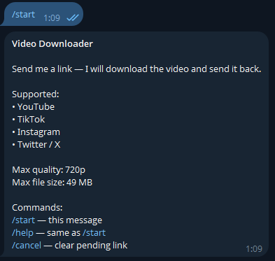

# Video Downloader Bot

[](LICENSE)




Telegram bot that downloads videos from YouTube, TikTok, Instagram, and Twitter/X. Send a link, pick quality, get the video back.

## Features

- Send a link - bot asks for quality (360p / 480p / 720p)
- Powered by `yt-dlp` - reliable extraction from major platforms
- Auto-cleanup: files deleted from disk right after sending
- Streaming-friendly output (H.264 mp4, plays on all Telegram clients)
- Max file size 49 MB - Telegram Bot API limit
- Async: downloads run in a thread pool, bot stays responsive
- Inline keyboard for quality selection
- Clean error messages instead of raw tracebacks

## Supported sites

- YouTube (`youtube.com`, `youtu.be`)
- TikTok (`tiktok.com`)
- Instagram Reels and posts (`instagram.com`)
- Twitter / X (`twitter.com`, `x.com`)

## Stack

- Python 3.8+
- [aiogram 3.x](https://github.com/aiogram/aiogram) - async Telegram framework
- [yt-dlp](https://github.com/yt-dlp/yt-dlp) - video extraction
- [FFmpeg](https://ffmpeg.org/download.html) - required for merging video + audio
- `python-dotenv` - loads token from `.env`

## Setup

### 1. Clone

```bash
git clone https://github.com/qvaraz/video-downloader-bot.git
cd video-downloader-bot
```

### 2. Install Python dependencies

```bash
pip install -r requirements.txt
```

### 3. Install FFmpeg

Required for merging video and audio streams into a single mp4.

- **Windows**: download from [gyan.dev/ffmpeg/builds](https://www.gyan.dev/ffmpeg/builds/), unpack to `C:\ffmpeg\`, add `C:\ffmpeg\bin` to `PATH`, restart terminal.
- **macOS**: `brew install ffmpeg`
- **Linux**: `sudo apt install ffmpeg`

Verify:

```bash
ffmpeg -version
```

### 4. Create a bot in Telegram

1. Open Telegram, find [@BotFather](https://t.me/BotFather).
2. Send `/newbot`.
3. Enter a display name (e.g. `Video Downloader`).
4. Enter a username ending with `bot` (e.g. `qvaraz_dl_bot`).
5. Copy the token BotFather sends you - looks like `7123456789:AAHxxxxxxxxxxxxxxxxx`.

### 5. Configure

```bash
cp .env.example .env
```

Open `.env` and paste your token:

```
BOT_TOKEN=7123456789:AAHxxxxxxxxxxxxxxxxx
```

No quotes, no spaces around `=`.

### 6. Run

```bash
python bot.py
```

Should print `bot starting` and `Start polling`. Leave the window open - bot runs while this process is alive.

## Usage

1. Find your bot in Telegram by username.
2. Send `/start`.
3. Paste a video link from a supported site.
4. Pick a quality: `360p`, `480p`, or `720p`.
5. Wait for the download and upload. Video arrives in the chat.

Commands:

- `/start` - welcome message
- `/help` - same as `/start`
- `/cancel` - clear the pending link

## Project structure

```
video-downloader-bot/
├── bot.py
├── config.py
├── downloader.py
├── requirements.txt
├── .env.example
├── .gitignore
├── LICENSE
├── README.md
└── screenshots/
    └── demo.png
```

## Notes

- `.env` is ignored by git - never commit real tokens.
- Max output quality is 720p by default to stay under Telegram's 50 MB upload limit. Raise `MAX_HEIGHT` in `downloader.py` if you need more, but most videos over 720p will exceed the limit.
- If YouTube starts returning `Sign in to confirm you're not a bot`, update `yt-dlp`:

  ```bash
  pip install -U --pre yt-dlp
  ```

## License

MIT
